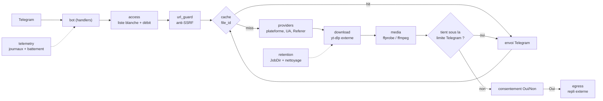

# Documentation technique

Vue d'ensemble et configuration : [README.md](README.md). Consignes pour agents : [AGENTS.md](AGENTS.md). Refonte : [FICHE](docs/refonte-rust/FICHE.md), [STATS](docs/refonte-rust/STATS.md), [INGEST](docs/refonte-rust/INGEST.md).

## Architecture



| Module | Fichier | Rôle |
|---|---|---|
| `config` | `src/config.rs` | variables d'environnement typées, lues une fois |
| `bot` | `src/bot/` | état partagé (`mod.rs`), commandes et boutons (`handlers.rs`), `/stats` (`stats.rs`), échappement MarkdownV2 (`markdown.rs`) |
| `access` | `src/access.rs` | liste blanche, administrateurs, débit par fenêtre de 60 s |
| `url_guard` | `src/url_guard.rs` | http(s) seulement, résolution DNS, refus des adresses non publiques |
| `providers` | `src/providers/` | détection YouTube / TikTok / Instagram / X / générique, User-Agent et Referer, extraction des liens d'un texte |
| `download` | `src/download.rs` | pilote `yt-dlp` en sous-processus (sans playlist, taille et durée bornées, nom par identifiant) |
| `media` | `src/media.rs` | sonde `ffprobe` (piste audio absente ou muette), conversion MP3, recompression sous la limite Telegram |
| `egress` | `src/egress.rs` | envoi vers `EXTERNAL_UPLOAD_URL` ; la réponse doit être exactement une URL https |
| `cache` | `src/cache.rs` | `file_id` Telegram par URL normalisée et mode, TTL `CACHE_TTL_H`, 10 000 entrées au plus |
| `retention` | `src/retention.rs` | un dossier verrouillé par tâche (`JobDir`), nettoyage par âge ou par manque d'espace sans toucher aux tâches actives |
| `telemetry` | `src/telemetry.rs` | journaux `tracing` (texte ou JSON), battement de cœur du healthcheck |
| `error` | `src/error.rs` | erreurs typées et messages affichés à l'utilisateur |

Déroulé d'une tâche (`src/bot/handlers.rs`) : chaque requête est lancée dans sa propre tâche tokio, donc un téléchargement ne bloque pas le dispatcher. Contrôle d'accès et débit, validation de l'URL, consultation du cache, attente d'une place (sémaphore `MAX_CONCURRENT_DOWNLOADS`), téléchargement dans un `JobDir`, avertissement si la vidéo n'a pas de son, recompression si besoin, envoi. Si le fichier ne peut pas tenir sous la limite, un message avec boutons Oui/Non est envoyé (valable 10 minutes) ; l'envoi externe n'a lieu qu'après « Oui ». Le message de progression est édité en place, puis supprimé en cas de succès ; toute erreur est renvoyée à l'utilisateur.

Point d'entrée : `src/main.rs`. `socialvideodownload --healthcheck` sort en 0 si le fichier `HEARTBEAT_FILE` a été touché récemment, sinon en 1.

### Tâches de fond et réglages

`download::spawn_updater` (mise à jour périodique de yt-dlp) et `retention::spawn_janitor` (nettoyage) sont lancés au démarrage (`spawn_background`). Le nettoyage relit les rétentions et l'espace libre minimal de `/settings` à chaque passage ; son intervalle (`sto.cleanup_min`) est pris au démarrage. Le module `src/settings/` porte le schéma, le stockage atomique et l'audit ; `src/providers/` porte le routeur des sources directes, branché dans `Downloader::with_settings`. Menus, clés et sources : [README.md](README.md#réglages-à-chaud--settings).

## Configuration

Tableau complet des variables et de leurs défauts : [README.md](README.md#configuration).

## Lancement

Local : `cargo run --release` avec les variables du `.env` exportées. Docker : `docker compose up -d --build` (le compose lit `.env` ; ses valeurs l'emportent sur les `ENV` de l'image, par exemple `YTDLP_PATH`, `FFMPEG_PATH`, `DOWNLOAD_DIR`). Dans l'image, `WORKDIR` est `/data`, donc `./downloads` vaut `/data/downloads`.

Le `Dockerfile` a quatre étapes : compilation Rust (`cargo build --release --locked`), `ffmpeg`/`ffprobe` statiques, `yt-dlp_linux` vérifié par sha256, image finale Debian slim avec l'utilisateur `svd` (UID 10001). Toutes les images de base sont épinglées par digest.

## Tests

```bash
cargo test --locked
```

- Tests unitaires dans chaque module (`src/**`).
- `tests/e2e.rs` : 12 parcours du vrai `bot::run` contre le faux Telegram `tests/fake_telegram/mod.rs` (serveur axum), avec `UNSAFE_ALLOW_PRIVATE_HOSTS=0` et de faux outils `tests/fixtures/fake-*.cmd|.sh`.
- `tests/RESULTAT-mutations.txt` : mutations jouées pour prouver que les tests deviennent rouges.
- `bench/` : banc de mesure commun à l'ancien et au nouveau bot (voir `bench/README.md`).

## CI

`.github/workflows/ci-rust.yml`, déclenché sur `push` (`main`, `develop`, `refonte-rust`) et `pull_request`, runners `ubuntu-latest`, publication GHCR multi-architecture (amd64 + arm64) sur `main` (`latest`, version de `.env.example`, SHA) et `develop` (`dev`, SHA), actions épinglées par SHA, droits `contents: read`.

| Job | Étapes |
|---|---|
| `check` | `cargo fmt --check`, `cargo clippy --locked --all-targets -- -D warnings`, `cargo test --locked` (Rust 1.99.0) |
| `audit` | `cargo install cargo-audit --version 0.22.2 --locked`, `cargo audit --deny warnings` |
| `image` | build Docker `svd-rust:ci`, scan Trivy (CRITICAL,HIGH, vulnérabilités corrigeables) |
| `publish` | après les trois autres, uniquement sur `push` vers `main` : connexion GHCR, push `latest` et `<sha>` |

## Sécurité

- **Accès** : `ALLOWED_USER_IDS` (vide = refus total sauf `ALLOW_ALL_USERS`), `/stats` réservé à `ADMIN_USER_IDS`, comparés par ID numérique.
- **Débit** : `RATE_LIMIT_PER_MIN` par utilisateur ; `MAX_CONCURRENT_DOWNLOADS` global.
- **Anti-SSRF** (`src/url_guard.rs`) : limite connue, la résolution faite ensuite par yt-dlp peut différer (DNS rebinding) ; atténuée par le cloisonnement du conteneur.
- **Consentement** : aucun fichier ne quitte Telegram sans « Oui ».
- **Conteneur** : non-root, lecture seule, `cap_drop: ALL`, `no-new-privileges`, limites mémoire/CPU/processus.
- **Secrets** : le jeton est masqué dans `Debug` et retiré des messages d'erreur journalisés. Ne jamais committer `.env`.

## Mise à jour de yt-dlp

Dans l'image : modifier `YTDLP_VERSION` et `YTDLP_SHA256` du `Dockerfile` (somme publiée dans les `SHA2-256SUMS` de la release yt-dlp), reconstruire, redéployer. Hors Docker : `yt-dlp --update-to stable`.

## Dépannage

- **Conflit `terminated by other getUpdates request`** : deux instances utilisent le même `BOT_TOKEN` ; arrêter l'autre.
- **Tout le monde est refusé** : `ALLOWED_USER_IDS` vide sans `ALLOW_ALL_USERS=1` (un avertissement est journalisé au démarrage).
- **Configuration invalide** : le bot sort immédiatement et journalise la clé fautive.
- **ffmpeg / ffprobe introuvable** : vérifier `FFMPEG_PATH` et `FFPROBE_PATH`.
- **Conteneur « unhealthy »** : le battement de cœur n'est plus écrit ; consulter `docker compose logs bot`.
- **TikTok ne télécharge plus** (`Unexpected response from webpage request`, IP de centre de données bloquée) : le bot envoie déjà un User-Agent Chrome et le Referer TikTok (`src/providers/`). Mettre yt-dlp à jour (section précédente) et chercher l'erreur exacte dans les tickets de yt-dlp, qui indiquent la version recommandée.
- **Journaux** : `RUST_LOG=debug` et `LOG_FORMAT=json` pour plus de détail.
