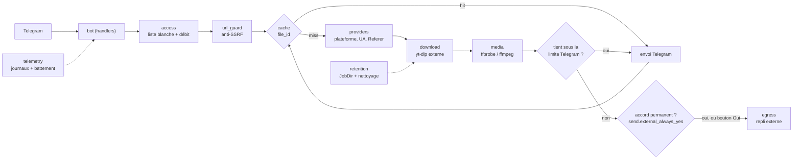

# Documentation technique

Vue d'ensemble et configuration : [README.md](README.md). Consignes pour agents : [AGENTS.md](AGENTS.md). Refonte : [FICHE](docs/refonte-rust/FICHE.md), [STATS](docs/refonte-rust/STATS.md), [INGEST](docs/refonte-rust/INGEST.md), [audit 1:1](docs/refonte-rust/AUDIT-1-1.md).

## Architecture



| Module | Fichier | Rôle |
|---|---|---|
| `config` | `src/config.rs` | variables d'environnement typées, lues une fois |
| `bot` | `src/bot/` | état partagé (`mod.rs`), commandes et boutons (`handlers.rs`), `/stats` (`stats.rs`), échappement MarkdownV2 (`markdown.rs`) |
| `access` | `src/access.rs` | liste blanche, administrateurs, débit en seau de jetons (rafale `RATE_LIMIT_BURST`, recharge `RATE_LIMIT_PER_MIN`) |
| `url_guard` | `src/url_guard.rs` | http(s) seulement, résolution DNS, refus des adresses non publiques |
| `providers` | `src/providers/` | détection YouTube / TikTok / Instagram / X / générique, User-Agent et Referer, extraction des liens d'un texte |
| `download` | `src/download.rs` | pilote `yt-dlp` en sous-processus (sans playlist, taille et durée bornées, fichier de travail nommé par identifiant, envoyé sous le titre de la vidéo comme le bot Python) |
| `media` | `src/media.rs` | sonde `ffprobe` (piste audio absente ou muette), conversion MP3, recompression sous la limite Telegram |
| `egress` | `src/egress.rs` | envoi `PUT` vers `EXTERNAL_UPLOAD_URL` (`https://curl.libriciel.fr/` par défaut), fichier renommé par son sha256 et 3 essais comme le bot Python ; la réponse doit être une URL https |
| `cache` | `src/cache.rs` | `file_id` Telegram par URL normalisée et mode, TTL `CACHE_TTL_H`, 10 000 entrées au plus |
| `retention` | `src/retention.rs` | un dossier verrouillé par tâche (`JobDir`), nettoyage par âge ou par manque d'espace sans toucher aux tâches actives |
| `telemetry` | `src/telemetry.rs` | journaux `tracing` au format du bot Python (console en couleurs, fichier `LOGS_DIR/AAAA-MM-JJ.log` sans couleurs, un par jour) ou JSON, battement de cœur du healthcheck |
| `error` | `src/error.rs` | erreurs typées et messages affichés à l'utilisateur |

Déroulé d'une tâche (`src/bot/handlers.rs`) : chaque requête est lancée dans sa propre tâche tokio, donc un téléchargement ne bloque pas le dispatcher. Contrôle d'accès et débit, validation de l'URL, consultation du cache, attente d'une place (sémaphore `MAX_CONCURRENT_DOWNLOADS`), contrôle de l'espace libre, téléchargement dans un `JobDir` (3 tentatives, comme le bot Python), avertissement si la vidéo n'a pas de son, recompression si `send.compress` est actif, envoi (vidéo, audio ou document selon l'extension, progression par paliers de 10 %). Un fichier au-delà de la limite part chez l'hébergeur externe et le bot répond avec le lien ; par défaut, un message avec boutons Oui/Non est d'abord envoyé (valable 10 minutes) et l'envoi n'a lieu qu'après « Oui ». « Accord permanent » dans `/settings` (ou `EXTERNAL_UPLOAD_CONSENT=0`) envoie directement, comme le bot Python. Le message de progression est édité en place, puis supprimé en cas de succès ; toute erreur est renvoyée à l'utilisateur.

Point d'entrée : `src/main.rs`. `socialvideodownload --healthcheck` sort en 0 si le fichier `HEARTBEAT_FILE` a été touché récemment, sinon en 1.

### Tâches de fond et réglages

Au démarrage, `retention::clear_downloads` vide le dossier de téléchargements (comme `clear_downloads()` du bot Python), puis `download::spawn_updater` (mise à jour périodique de yt-dlp) et `retention::spawn_janitor` (nettoyage, premier passage immédiat) sont lancés (`spawn_background`). Le nettoyage relit les rétentions et l'espace libre minimal de `/settings` à chaque passage ; son intervalle (`sto.cleanup_min`) est pris au démarrage. `retention::check_and_clean_if_needed` vérifie aussi l'espace libre avant chaque téléchargement, comme le bot Python. Le module `src/settings/` porte le schéma, le stockage atomique et l'audit ; `src/providers/` porte le routeur des sources directes, branché dans `Downloader::with_settings`. Menus, clés et sources : [README.md](README.md#réglages-à-chaud--settings).

## Configuration

Tableau complet des variables et de leurs défauts : [README.md](README.md#configuration).

## Lancement

Local : `cargo run --release` ; le bot lit `./.env` lui-même sans écraser l'environnement (comme `load_dotenv(override=False)`) ; sans `.env` ou avec le jeton modèle, il crée le fichier ou dit quoi renseigner, puis s'arrête. Docker : `docker compose up -d --build` (le compose lit `.env` ; ses valeurs l'emportent sur les `ENV` de l'image, par exemple `YTDLP_PATH`, `FFMPEG_PATH`, `DOWNLOAD_DIR`). Dans l'image, `WORKDIR` est `/data`, donc `./downloads` vaut `/data/downloads`.

Le `Dockerfile` a quatre étapes : compilation Rust (`cargo build --release --locked`), `ffmpeg`/`ffprobe` statiques, `yt-dlp_linux` vérifié par sha256, image finale Debian slim avec l'utilisateur `svd` (UID 10001). Toutes les images de base sont épinglées par digest. Le `docker-compose.yml` la lance en root comme le bot Python, avec la seule capacité `DAC_OVERRIDE`, pour écrire dans `./downloads`, `./logs` et `./state` quel que soit leur propriétaire (sans elle, root est refusé sur un dossier `1000:1000`, essai Docker du 06/11/2026).

## Tests

```bash
cargo test --locked
```

- Tests unitaires dans chaque module (`src/**`).
- `tests/e2e.rs` : 15 parcours du vrai `bot::run` contre le faux Telegram `tests/fake_telegram/mod.rs` (serveur axum), avec `UNSAFE_ALLOW_PRIVATE_HOSTS=0` et de faux outils `tests/fixtures/fake-*.cmd|.sh`.
- `tests/e2e_settings.rs` (8, `/settings` par boutons), `tests/e2e_providers.rs` (5, sources directes), `tests/startup.rs` (3, nettoyage, mise à jour de yt-dlp, espace disque), `tests/token_redaction.rs` (4, jeton masqué dans les journaux).
- `tests/RESULTAT-mutations.txt` : mutations jouées pour prouver que les tests deviennent rouges.
- `bench/` : banc de mesure commun à l'ancien et au nouveau bot (voir `bench/README.md`).

## CI

`.github/workflows/ci-rust.yml`, déclenché sur `push` (`main`, `develop`, `refonte-rust`) et `pull_request`, runners `ubuntu-latest`, publication GHCR multi-architecture (amd64 + arm64) sur `main` (`latest`, version de `.env.example`, SHA) et `develop` (`dev`, SHA), actions épinglées par SHA, droits `contents: read`.

| Job | Étapes |
|---|---|
| `check` | `cargo fmt --check`, `cargo clippy --locked --all-targets -- -D warnings`, `cargo test --locked` (Rust 1.99.0) |
| `audit` | `cargo install cargo-audit --version 0.22.2 --locked`, `cargo audit --deny warnings` |
| `image` | build Docker `svd-rust:ci`, scan Trivy (CRITICAL,HIGH, vulnérabilités corrigeables) |
| `publish` | après les trois autres, sur `push` vers `main` (`latest`, version de `.env.example`, `<sha>`) ou `develop` (`dev`, `<sha>`) : connexion GHCR, image amd64 + arm64 |

## Sécurité

- **Accès** : ouvert à tous par défaut comme le bot Python ; `ALLOWED_USER_IDS` le restreint (les administrateurs gardent l'accès) ; `/stats` et `/settings` réservés à `ADMIN_USER_IDS` ; toujours par ID numérique.
- **Débit** : seau de jetons par utilisateur, `RATE_LIMIT_BURST` (20) liens d'affilée puis `RATE_LIMIT_PER_MIN` (10) par minute ; `MAX_CONCURRENT_DOWNLOADS` global.
- **Anti-SSRF** (`src/url_guard.rs`) : limite connue, la résolution faite ensuite par yt-dlp peut différer (DNS rebinding) ; atténuée par le cloisonnement du conteneur.
- **Repli externe** : vers `curl.libriciel.fr` par défaut, comme le bot Python ; le « Oui » de l'utilisateur est demandé à chaque fichier, sauf « Accord permanent » dans `/settings` (ou `EXTERNAL_UPLOAD_CONSENT=0`) ; `EXTERNAL_UPLOAD_URL=off` ou `/settings` le coupe.
- **Conteneur** : image en UID 10001 ; compose en root avec la seule capacité `DAC_OVERRIDE` (`cap_drop: ALL` puis `cap_add`), lecture seule, `no-new-privileges`, limites mémoire/CPU/processus.
- **Secrets** : le jeton est masqué dans `Debug` et retiré des messages d'erreur journalisés. Ne jamais committer `.env`.

## Mise à jour de yt-dlp

Dans l'image : modifier `YTDLP_VERSION` et `YTDLP_SHA256` du `Dockerfile` (somme publiée dans les `SHA2-256SUMS` de la release yt-dlp), reconstruire, redéployer. Hors Docker : `yt-dlp --update-to stable`.

## Dépannage

- **Conflit `terminated by other getUpdates request`** : deux instances utilisent le même `BOT_TOKEN` ; arrêter l'autre.
- **Un utilisateur est refusé** : `ALLOWED_USER_IDS` est renseignée et son ID numérique n'y figure pas, ni dans `ADMIN_USER_IDS`.
- **Configuration invalide** : le bot sort immédiatement et journalise la clé fautive.
- **`.env` absent ou jeton modèle** : le bot crée `.env` depuis son modèle (ou signale la valeur par défaut), demande de renseigner `BOT_TOKEN` et s'arrête, comme le bot Python.
- **ffmpeg / ffprobe introuvable** : vérifier `FFMPEG_PATH` et `FFPROBE_PATH`.
- **Conteneur « unhealthy »** : le battement de cœur n'est plus écrit ; consulter `docker compose logs bot`.
- **TikTok ne télécharge plus** (`Unexpected response from webpage request`, IP de centre de données bloquée) : le bot envoie déjà un User-Agent Chrome et le Referer TikTok (`src/providers/`). Mettre yt-dlp à jour (section précédente) et chercher l'erreur exacte dans les tickets de yt-dlp, qui indiquent la version recommandée.
- **Journaux** : console et `LOGS_DIR/AAAA-MM-JJ.log` (un fichier par jour, `./logs` avec le compose), niveau `debug` par défaut comme le bot Python ; `RUST_LOG` (par exemple `info`) l'emporte sur `sys.log_level`, `LOG_FORMAT=json` donne du JSON.
