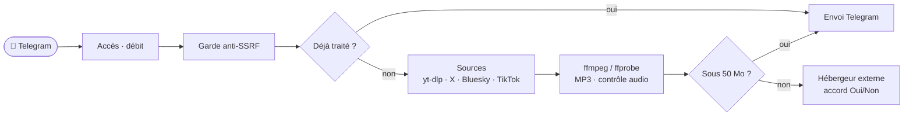

<div align="center">

# 🎬 SocialVideoDownload.rs

Bot Telegram de téléchargement vidéo/audio depuis les réseaux sociaux (YouTube, TikTok, etc.) via `yt-dlp`, réécrit en Rust.

[](https://github.com/OverStyleFR/SocialVideoDownload.rs/actions/workflows/ci-rust.yml)
[](https://www.rust-lang.org/)
[](https://creativecommons.org/licenses/by-nc-sa/4.0/)

</div>

---

## 🎯 Fonctionnalités

- 📥 **Téléchargement vidéo** – `/download <lien>`
- 🎵 **Extraction audio MP3** – `/music <lien>`
- ⚡ **Auto-détection** – envoyez un lien dans la conversation, le bot le télécharge
- 👥 **Plusieurs à la fois** – une tâche par message, un téléchargement lent ne bloque pas les autres
- 📤 **Gros fichiers** – au-delà de 50 Mo, envoi chez un hébergeur externe, avec l'accord de l'utilisateur
- 🔁 **Cache** – un lien déjà traité est renvoyé sans nouveau téléchargement (24 h)
- 🚦 **Débit limité** – 20 liens d'affilée, puis 10 par minute et par utilisateur
- 🧹 **Nettoyage** – conservation distincte pour les petits et les gros fichiers, espace disque surveillé
- 🔘 **Réglages à chaud** – menu `/settings` par boutons, réservé aux administrateurs
- 🌐 **Sources directes** – X, Bluesky et TikTok, en option
- 🦀 **Rust** – teloxide et tokio, conteneur durci

---

## 🤖 Commandes Telegram

| Commande | Effet |
|---|---|
| `/start` | message d'accueil |
| `/help` | aide, avec la version et l'auteur |
| `/download <lien>` | télécharge la vidéo (MP4) |
| `/music <lien>` | extrait l'audio (MP3) |
| `/stats` | statistiques (administrateurs) |
| `/settings` | réglages par boutons (administrateurs) |
| un lien seul | télécharge comme `/download` |

---

## 🧭 Fonctionnement



---

## 📦 Démarrage rapide

### 🐳 Docker Compose (recommandé)

```bash
git clone https://github.com/OverStyleFR/SocialVideoDownload.rs.git
cd SocialVideoDownload.rs
cp .env.example .env
# Éditer .env : renseigner BOT_TOKEN et ADMIN_USER_IDS
docker compose up -d --build
docker compose logs -f bot
```

Le token peut aussi être passé via variable d'environnement (prioritaire sur `.env`) :

```bash
BOT_TOKEN=123456789:VOTRE_JETON docker compose up -d --build
```

Le bot est prêt quand les journaux affichent `[INIT] Démarrage du bot et lancement du polling...`.

### 🦀 Sans Docker

Prérequis : Rust 1.99, et `yt-dlp`, `ffmpeg` et `ffprobe` dans le `PATH`.

```bash
cp .env.example .env
cargo run --release
```

### 🔄 Mise à jour

```bash
git pull
docker compose up -d --build
```

Les dossiers `downloads/`, `logs/` et `state/` sont montés depuis l'hôte : ils restent en place.

---

## ⚙️ Configuration

`.env.example` liste chaque variable avec sa valeur par défaut. Seul `BOT_TOKEN` est obligatoire.

| Variable | Obligatoire | Description | Défaut |
|---|:---:|---|---|
| `BOT_TOKEN` | ✅ | jeton du bot, jamais écrit dans les journaux | — |
| `ADMIN_USER_IDS` | ❌ | IDs numériques des administrateurs : `/stats` et `/settings` | vide |
| `ALLOWED_USER_IDS` | ❌ | restreint le bot à ces IDs (séparés par des virgules) | vide (ouvert à tous) |
| `RATE_LIMIT_BURST` / `RATE_LIMIT_PER_MIN` | ❌ | liens d'affilée, puis liens par minute, par utilisateur | `20` / `10` |
| `MAX_CONCURRENT_DOWNLOADS` | ❌ | téléchargements simultanés | `3` |
| `MAX_FILESIZE_MB` / `MAX_DURATION_S` | ❌ | taille (Mo) et durée (s) maximales d'un média | `500` / `3600` |
| `TELEGRAM_UPLOAD_LIMIT_MB` | ❌ | au-delà, le fichier part chez l'hébergeur externe | `50` |
| `EXTERNAL_UPLOAD_URL` | ❌ | hébergeur du repli externe ; vide ou `off` le désactive | `https://curl.libriciel.fr/` |
| `EXTERNAL_UPLOAD_CONSENT` | ❌ | `1` : demande Oui/Non avant chaque envoi externe ; `0` : envoi direct | `1` |
| `RETENTION_SMALL_HOURS` / `RETENTION_LARGE_HOURS` | ❌ | conservation des petits et des gros fichiers, en heures | `24` / `2` |
| `CLEANUP_INTERVAL_HOURS` | ❌ | intervalle du nettoyage périodique, en heures | `48` |

Les administrateurs sont toujours admis, même si `ALLOWED_USER_IDS` est renseignée. `ADMIN_USER_IDS` seul ne restreint rien.

<details>
<summary><b>Toutes les variables</b></summary>

| Variable | Défaut | Rôle |
|---|---|---|
| `ALLOW_ALL_USERS` | `0` | `1` ouvre le bot à tous, même si `ALLOWED_USER_IDS` est renseignée |
| `TELEGRAM_API_URL` | `https://api.telegram.org` | adresse de l'API Telegram |
| `DOWNLOAD_DIR` | `./downloads` | dossier de travail, vidé au démarrage |
| `LOGS_DIR` | `logs/` à côté de `downloads/` | dossier des journaux |
| `SETTINGS_FILE` | `state/settings.json` (avec Docker) | fichier des réglages `/settings` |
| `RETENTION_HOURS` | absente | valeur de repli pour les deux durées de rétention |
| `SMALL_FILE_SIZE_MB` | `12` | seuil entre petit et gros fichier |
| `MIN_FREE_SPACE_MB` | `500` | espace disque libre visé par le nettoyage d'urgence (alias `MIN_FREE_DISK_MB`) |
| `CACHE_TTL_H` | `24` | durée de vie du cache des liens, en heures |
| `HEARTBEAT_FILE` | `/tmp/svd-heartbeat` | fichier de battement de cœur lu par le healthcheck |
| `YTDLP_PATH` / `FFMPEG_PATH` / `FFPROBE_PATH` | `yt-dlp` / `ffmpeg` / `ffprobe` | chemins des outils ; un chemin FFmpeg introuvable retombe sur `ffmpeg` du `PATH` |
| `YTDLP_UPDATE_INTERVAL_H` | `24` | mise à jour de yt-dlp, en heures ; `0` = jamais |
| `EXTERNAL_UPLOAD_TIMEOUT_S` | `300` | délai maximal de l'envoi externe, en secondes |
| `VERSION` / `DEVELOPED_BY` | `unknown` / `Tom V. \| OverStyleFR` | affichés par `/help` (`VERSION` vaut `V10.0.1` dans `.env.example`) |
| `LOG_FORMAT` | texte | `json` pour des journaux au format JSON (variable d'environnement) |
| `RUST_LOG` | `debug` | filtre des journaux, prime sur `sys.log_level` (variable d'environnement) |
| `NO_COLOR` | absente | si elle est définie, la console n'affiche pas de couleurs (variable d'environnement) |
| `UNSAFE_ALLOW_PRIVATE_HOSTS` | `0` | désactive la garde anti-SSRF : tests et bancs seulement |

</details>

---

## 🎛️ Réglages à chaud : `/settings`

Le menu `/settings` se gère entièrement par boutons, réservé aux administrateurs. Les réglages sont enregistrés dans `state/settings.json`, qui l'emporte sur le `.env`. Chaque modification est consignée dans `state/settings-audit.jsonl`.

```text
/settings
├── Téléchargement   taille, durée, qualité
├── Sources          X, Bluesky, TikTok, ordre, repli yt-dlp
├── Audio            /music, débit MP3
├── Envoi            limite Telegram, repli externe, accord permanent, compression
├── Stockage         rétention, espace libre, nettoyage
├── Accès            utilisateurs autorisés, débit, administrateurs
└── Système          version, mise à jour de yt-dlp, niveau de journaux
```

La plupart des réglages s'appliquent tout de suite. `sto.cleanup_min`, `sys.ytdlp_update_h` et `sys.log_level` prennent effet au prochain démarrage.

---

## 🌐 Sources directes

Par défaut, tout passe par yt-dlp. Chaque source directe s'active dans `/settings` › Sources.

| Source | Sites | Par défaut |
|---|---|---|
| **yt-dlp** | les sites pris en charge par yt-dlp | toujours active |
| **X** | `x.com`, `twitter.com` | désactivée |
| **Bluesky** | `bsky.app` | désactivée |
| **TikTok** | `tiktok.com` | désactivée |

Une source activée est essayée avant yt-dlp. Si elle échoue, yt-dlp prend le relais tant que le repli est actif.

> ⚠️ La source TikTok passe par un service tiers, hors de contrôle du projet.
> ⚠️ Les API publiques de X et Bluesky peuvent changer sans préavis.

---

## 🛡️ Sécurité

- **Anti-SSRF** : seules les URL `http` et `https` vers des adresses publiques sont acceptées. Les adresses privées, locales et internes sont refusées.
- **Accord externe** : avant tout envoi chez l'hébergeur externe, l'utilisateur doit accepter (sauf accord permanent activé par un administrateur).
- **Jeton** : jamais écrit dans les journaux ni dans les messages d'erreur.
- **Conteneur** : lancé en root comme le bot Python, avec la seule capacité `DAC_OVERRIDE`, système de fichiers en lecture seule, `no-new-privileges`, 512 Mo de mémoire et 1 CPU.

---

## 🧪 Tests et CI

```bash
cargo fmt --check
cargo clippy --locked --all-targets -- -D warnings
cargo test --locked
```

Le workflow [`ci-rust.yml`](.github/workflows/ci-rust.yml) enchaîne `check`, `audit`, `image` (scan Trivy) et `publish`. Ce dernier publie sur GHCR en amd64 et arm64, pour les pushes sur `main` et `develop`. Sur `main` : `latest`, la version de `.env.example` et le SHA. Sur `develop` : `dev` et le SHA.

---

## 📚 Documentation

- [DOCS.md](DOCS.md) : architecture, déroulé d'une tâche, dépannage
- [AGENTS.md](AGENTS.md) : consignes pour les agents qui travaillent sur le code
- [docs/refonte-rust/](docs/refonte-rust/) : audit de l'ancien bot, mesures et comparaison avec la version Python
- Egg Pelican / Pterodactyl : [`pelican/egg-socialvideodownload.json`](pelican/egg-socialvideodownload.json)

---

## 👥 Crédits

- Développé par Tom V. | OverStyleFR
- Refonte Rust : Toji ([@TojiiSamaa](https://github.com/TojiiSamaa))

---

## 📄 Licence

Ce projet est distribué sous la licence **Creative Commons Attribution - Pas d'Utilisation Commerciale - Partage dans les Mêmes Conditions 4.0 International** (CC BY-NC-SA 4.0). Le texte complet est dans [LICENSE](LICENSE).

- ✅ Utiliser, modifier et redistribuer, en citant l'auteur.
- 🚫 Aucune utilisation commerciale.
- 🔁 Les versions modifiées se partagent sous la même licence.
