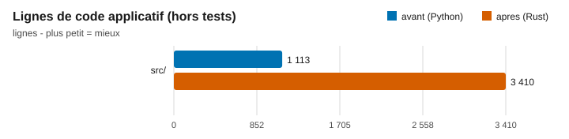
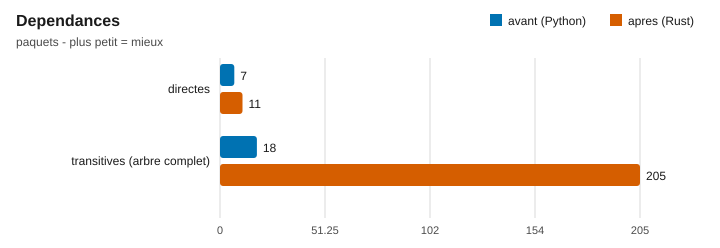
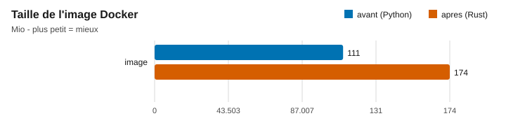
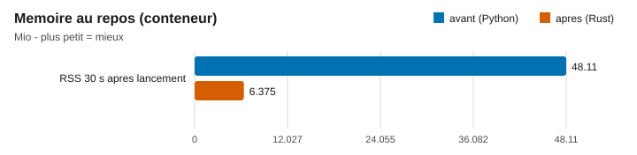
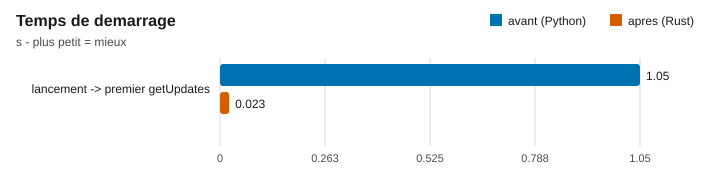
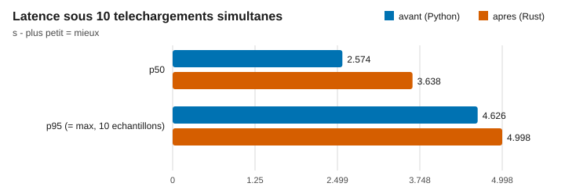
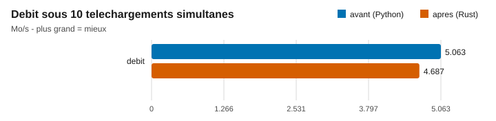

# Statistiques avant / après : bot Python vers bot Rust

Avant : ancien bot Python (commit a467a68). Après : bot Rust (commit 6f42b8a, branche `refonte-rust`).
Chaque chiffre vient de `mesures/avant.json` et `mesures/apres.json` ; les commandes exactes sont dans `mesures/avant.md` et `mesures/apres.md`. Les graphes et les écarts sont générés par `bench/graphes.py` (stdlib seulement, aucun chiffre saisi à la main).
`$SCR` = dossier de travail hors git (binaire de banc, mp4 de test, venv de l'ancien bot).

## Tableau

Écart = (après − avant) / avant. Étiquette : MESURÉ = sorti d'une commande rejouable ; DÉDUIT = calculé à partir de mesures. Latence, débit et démarrage : médiane de 3 runs.

| Métrique | Avant | Après | Écart | Étiquette | Commande de rejeu |
|---|---|---|---|---|---|
| Lignes de code applicatif | 1 113 (Python, 21 fichiers) | 3 410 (Rust, `src/`) | +206,4 % | MESURÉ | `git ls-files '*.py' \| grep -v '^ffmpeg/' \| xargs wc -l \| tail -1` (avant) ; `git ls-files 'src/*.rs' \| xargs wc -l \| tail -1` (après) |
| Lignes de tests | non mesuré | 616 (Rust, `tests/`) | sans objet | MESURÉ | `git ls-files 'tests/*.rs' 'tests/**/*.rs' \| xargs wc -l \| tail -1` |
| Tests | 0 fichier de test suivi | 60 : 48 unitaires + 12 e2e ; 8 mutations (7 rouges, M7 restée verte puis test renforcé) | sans objet | MESURÉ | `git ls-tree -r --name-only a467a68 | grep -ci test` (avant) ; `cargo test -- --list` (après) ; `tests/RESULTAT-mutations.txt` (mutations) |
| Dépendances directes | 7 | 11 | +57,1 % | MESURÉ | `wc -l < requirements.txt` (avant) ; section `[dependencies]` de `Cargo.toml` (après) |
| Dépendances totales | 18 (venv) | 205 (arbre cargo) | +1 038,9 % | MESURÉ | `pip list --format=freeze \| wc -l` (avant) ; `cargo tree --prefix none -e normal \| sort -u \| wc -l` (après) |
| Taille d'image Docker | 116 510 831 o (111,1 Mio) | 182 466 181 o (174,0 Mio) | +56,6 % | MESURÉ | `docker build -t <tag> . && docker image inspect --format '{{.Size}}' <tag>` |
| Mémoire au repos (30 s) | 37,98 Mio | 1,379 Mio | −96,4 % | MESURÉ | `docker run -d ... <image>`, 30 s, `docker stats --no-stream` (voir `apres.md`) |
| Temps de démarrage | 1,05 s | 0,023 s | −97,8 % | MESURÉ | `python bench/run_bench.py ...`, champ `startup_s` |
| Latence p50, 10 simultanés | 2,574 s | 3,638 s | +41,3 % | MESURÉ | `python bench/run_bench.py ...`, champ `latency_p50_s` |
| Latence p95, 10 simultanés | 4,626 s | 4,998 s | +8,0 % | MESURÉ | idem, champ `latency_p95_s` |
| Débit, 10 simultanés | 5,063 Mo/s (2,162 fichiers/s) | 4,687 Mo/s (2,001 fichiers/s) | −7,4 % | MESURÉ | idem, champs `throughput_mb_per_s`, `throughput_files_per_s` |

Les écarts en pourcentage ci-dessus sont DÉDUITS des deux colonnes (division) ; les valeurs, elles, sont MESURÉES. Les pourcentages sont arrondis à 0,1 point.

Valeurs brutes des 3 runs (`runs_bruts` des JSON) :

| Run | Démarrage | p50 | p95 | Débit Mo/s |
|---|---|---|---|---|
| Rust 1 / 2 / 3 | 0,023 / 0,081 / 0,023 s | 3,638 / 5,415 / 3,079 s | 3,988 / 5,778 / 4,998 s | 5,873 / 4,054 / 4,687 |
| Python (origine) 1 / 2 / 3 | 1,05 / 1,065 / 0,836 s | 2,941 / 2,574 / 2,506 s | 5,293 / 4,529 / 4,626 s | 4,425 / 5,171 / 5,063 |
| Python (re-mesure) 1 / 2 / 3 | 1,851 / 1,143 / 1,102 s | 2,629 / 2,284 / 2,260 s | 4,741 / 4,162 / 4,233 s | 4,940 / 5,627 / 5,533 |

Re-mesure de l'avant (même session que l'après, faux Telegram corrigé) : médianes 2,284 s (p50), 4,233 s (p95), 5,533 Mo/s, démarrage 1,143 s. Écart avec l’avant d’origine : 11,3 % au plus (p50 ; p95 8,5 %, débit 9,3 %, démarrage 8,9 %), base = avant d’origine, arrondis à 0,1 point, donc le banc corrigé reste comparable. Contre cette re-mesure, le Rust serait à +59,3 % (p50), +18,1 % (p95) et −15,3 % (débit), arrondis à 0,1 point : l'ordre ne change pas, la conclusion non plus (voir Limites).

## Re-mesure du 2026-11-05 (commit f8f27ce, branche `refonte-rust`)

Les valeurs du tableau ci-dessus (commit 6f42b8a) restent la mesure de référence du banc ; celles-ci décrivent le code actuel. Les mesures de l'ancien bot (colonne Avant) sont inchangées.

| Métrique | Mesure du 6f42b8a | Mesure du f8f27ce | Étiquette | Commande de rejeu |
|---|---|---|---|---|
| Lignes de code Rust, `src/` | 3 410 | 6 007 | MESURÉ | `git ls-files 'src/*.rs' \| xargs wc -l \| tail -1` |
| Lignes de tests Rust, `tests/` | 616 | 1 362 | MESURÉ | `git ls-files 'tests/*.rs' 'tests/**/*.rs' \| xargs wc -l \| tail -1` |
| Dépendances directes | 11 | 11 | MESURÉ | `cargo tree --depth 1 -e normal` (12 lignes, racine comprise) ; `cargo tree --depth 1` (dev-deps comprises) donne 16 lignes, soit 15 |
| Dépendances totales | 205 | 205 | MESURÉ | `cargo tree --prefix none -e normal \| sort -u \| wc -l` |
| Tests | 60 | 114 : 83 unitaires (`src/lib.rs`) + 31 d'intégration (e2e 12, e2e_providers 5, e2e_settings 7, startup 3, token_redaction 4) | MESURÉ | `cargo test --no-fail-fast 2>&1 \| grep 'test result'`, somme des « passed » (83+0+12+5+7+3+4+0) |
| Taille d'image Docker | 182 466 181 o (174,0 Mio) | 182 623 255 o (174,2 Mio) | MESURÉ | `docker build -t wftfxzuk-e2 . && docker image inspect --format '{{.Size}}' wftfxzuk-e2` (image supprimée ensuite) |
| Taille du binaire release | non relevée | non relevée | DÉDUIT : non mesurée | pas de `cargo build --release` séparé lancé ; la taille est contenue dans l'image ci-dessus |
| Lignes Python de l'ancien dépôt (info) | 1 113 (a467a68) | 1 219 (`.py` suivis au f8f27ce, banc `bench/` compris) | MESURÉ | `git ls-files '*.py' \| grep -v '^ffmpeg/' \| xargs wc -l \| tail -1` ; non comparable à l'avant, ne pas l'utiliser pour les écarts |

Notes de cette re-mesure :
- Le premier `cargo test --no-fail-fast` a donné 113 passés et 1 échoué (`b_slow_user_does_not_block_other`, `tests/e2e.rs:127`) car `docker build` tournait en même temps ; relancé seul, `cargo test --test e2e` donne 12 passés, 0 échoué. Le total de 114 est la somme des sorties réelles (113 de la première passe + le test rejoué seul) ; le test est sensible à la charge machine (bug déclaré).
- Aucune mesure de latence, débit, mémoire ni démarrage n'a été refaite : les lignes correspondantes du premier tableau restent celles du 6f42b8a.
- Environnement : cargo/rustc comme ci-dessus, Docker 29.6.1, Valorant absent (`tasklist | grep -ic valorant` = 0). Date : 2026-11-05.

## Graphes

Générés par `python bench/graphes.py`, même échelle pour l'avant (bleu) et l'après (orange) dans chaque graphe.

Blocs Mermaid `xychart-beta` équivalents (première série : avant, seconde : après) : [graphes/mermaid.md](graphes/mermaid.md).

## Conditions de mesure

- Machine : PC Windows 11, Docker Desktop 29.6.1 (7,7 Go alloués), cargo et rustc 1.99.0.
- Même yt-dlp (2026.08.19) et même ffmpeg (8.1.2) pour les deux bots, hors Docker pour le banc de latence ; fichier de test mp4 de 2,34 Mo servi en local par `bench/media_server.py`.
- Charge : 10 messages de 10 utilisateurs différents injectés ensemble par le faux Telegram (`bench/fake_telegram.py`) ; `MAX_CONCURRENT_DOWNLOADS=10`, `ALLOWED_USER_IDS=1000..1009`, `UNSAFE_ALLOW_PRIVATE_HOSTS=1`.
- Répétitions : 3 runs de latence/débit/démarrage par bot, médiane retenue. Mémoire et taille d'image : une mesure chacune (conteneur, 30 s au repos).
- Bot Python hors Docker : Python 3.13 (le conteneur utilise 3.11) ; bot Rust hors Docker : binaire release.
- Date : 2026-11-05.

## Limites

- Le débit et la latence dépendent surtout de yt-dlp et de ffmpeg, qui restent des binaires externes dans les deux versions : Rust ne les accélère pas. Les écarts de latence (+41,3 % en p50) et de débit (−7,4 %) sont du même ordre que la dispersion entre runs (Rust : p50 de 3,079 à 5,415 s ; débit de 4,054 à 5,873 Mo/s) et ne prouvent pas que le Rust est plus lent ; ils prouvent qu'il n'est pas plus rapide sur ce banc. Aucune hypothèse sur la cause n'a été testée.
- Le p95 est calculé sur 10 échantillons : c'est le maximum, pas un percentile robuste.
- Le bot Rust a été mesuré avec un binaire patché d'un caractère (`duration? <=`, ligne 147 de `src/download.rs`) : sans durée connue, le filtre de yt-dlp du bot non patché rejette tout média (bug SOCIAL-2611050403-f13, à corriger dans `src/`). Les valeurs de latence et de débit ne valent donc que pour ce chemin. `src/` n'a pas été modifié par ce travail.
- Le faux Telegram du banc a dû être corrigé pour teloxide (champs manquants, corps chunked, appariement des réponses par `chat_id`). La re-mesure de l'ancien bot sur le banc corrigé donne des valeurs à 11,3 % au plus de l’origine (base = avant d’origine, arrondi à 0,1 point).
- Python 3.13 hors Docker pour l'avant : démarrage et latence ne sont pas strictement comparables à une exécution Linux en conteneur. Le démarrage Rust varie de 0,023 à 0,081 s sur les 3 runs (médiane 0,023 s).
- 205 dépendances = lignes distinctes de `cargo tree`, crate racine compris ; 18 pour Python = paquets du venv (pip et setuptools compris, 16 sans eux ; 19 dans l'image).
- Les lignes de code ne se comparent pas à fonctionnalité égale : le Rust compte les tests unitaires en ligne (`#[cfg(test)]`) dans `src/`, et la refonte ajoute des fonctions (anti-SSRF, cache, limites) absentes de l'ancien bot.
- Mémoire : 1,379 Mio est la valeur de `docker stats` (cgroup) du conteneur au repos, sans activité de téléchargement ; elle ne dit rien de la mémoire sous charge, non mesurée.
- L’image Rust est plus grosse (+56,6 %) ; elle embarque ffmpeg et yt-dlp épinglés (voir `Dockerfile`) ; la composition de l’image Python n’a pas été comparée couche par couche.
- L'envoi de fichiers de plus de 35 Mo (upload externe) n'est pas exercé par le banc.
