# Blocs Mermaid (generes par bench/graphes.py, ne pas editer)

## Lignes de code applicatif (hors tests)

```mermaid
xychart-beta
    title "Lignes de code applicatif (hors tests) (lignes)"
    x-axis ["src/"]
    y-axis "lignes" 0 --> 3751
    bar [1113]
    bar [3410]
```

Premiere serie : avant (Python). Seconde serie : apres (Rust).

## Dependances

```mermaid
xychart-beta
    title "Dependances (paquets)"
    x-axis ["directes", "transitives"]
    y-axis "paquets" 0 --> 225.5
    bar [7, 18]
    bar [11, 205]
```

Premiere serie : avant (Python). Seconde serie : apres (Rust).

## Taille de l'image Docker

```mermaid
xychart-beta
    title "Taille de l'image Docker (Mio)"
    x-axis ["image"]
    y-axis "Mio" 0 --> 191.414
    bar [111.113]
    bar [174.013]
```

Premiere serie : avant (Python). Seconde serie : apres (Rust).

## Memoire au repos (conteneur)

```mermaid
xychart-beta
    title "Memoire au repos (conteneur) (Mio)"
    x-axis ["RSS 30 s apres lancement"]
    y-axis "Mio" 0 --> 52.921
    bar [48.11]
    bar [6.375]
```

Premiere serie : avant (Python). Seconde serie : apres (Rust).

## Temps de demarrage

```mermaid
xychart-beta
    title "Temps de demarrage (s)"
    x-axis ["lancement -> premier getUpdates"]
    y-axis "s" 0 --> 1.155
    bar [1.05]
    bar [0.023]
```

Premiere serie : avant (Python). Seconde serie : apres (Rust).

## Latence sous 10 telechargements simultanes

```mermaid
xychart-beta
    title "Latence sous 10 telechargements simultanes (s)"
    x-axis ["p50", "p95"]
    y-axis "s" 0 --> 5.498
    bar [2.574, 4.626]
    bar [3.638, 4.998]
```

Premiere serie : avant (Python). Seconde serie : apres (Rust).

## Debit sous 10 telechargements simultanes

```mermaid
xychart-beta
    title "Debit sous 10 telechargements simultanes (Mo/s)"
    x-axis ["debit"]
    y-axis "Mo/s" 0 --> 5.569
    bar [5.063]
    bar [4.687]
```

Premiere serie : avant (Python). Seconde serie : apres (Rust).
